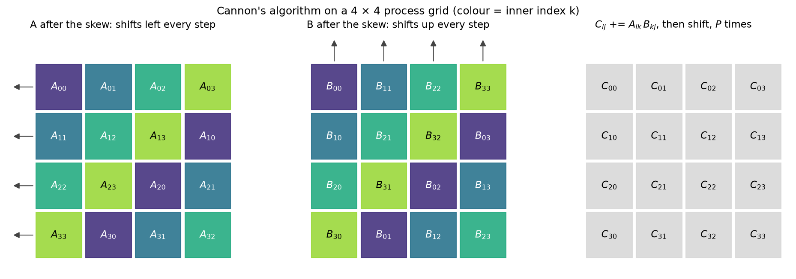
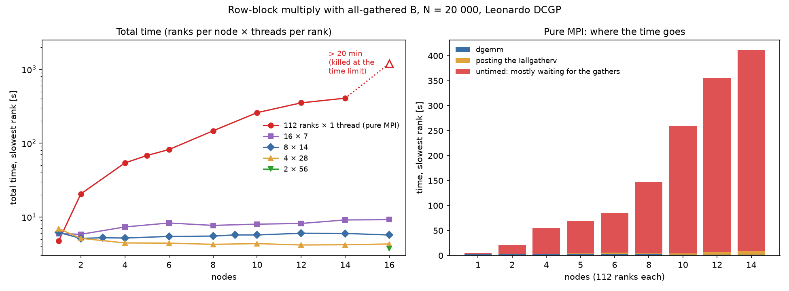
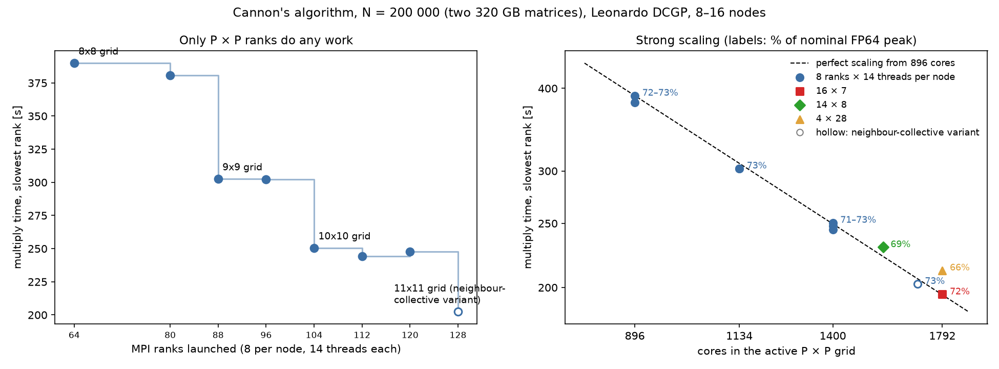
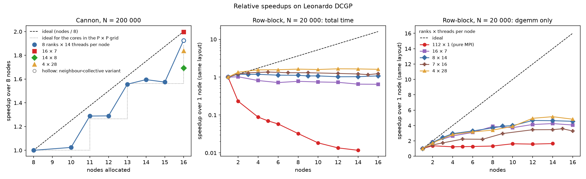

# Matrix Multiplication with MPI and Canon's Algorithm


<sub>After the initial skew, process (i, j) holds the A and B blocks with the same inner index k (same colour), multiplies them, then A shifts left and B shifts up.</sub>

Multiplying small matrices is a straightforward implementation, where our algorithm can basically follow the matrix multiplication procedure we learned all the way back in high school. But what if just one matrix has $4 \times 10^{10}$ doubles, coming out to be 320 GB? 

In this repo we multiply really big dense matrices across many nodes with MPI + OpenMP in C++20. We start with the simple approach (every rank gathers B and multiplies its own rows) and watch it fall over, then move to Cannon's algorithm on a 2D Cartesian process grid, which we push to two $200\,000 \times 200\,000$ matrices on up to 16 nodes on CINECA's Leonardo. Written for the *Parallel Programming* course in the [Master in High Performance Computing (MHPC)](https://www.mhpc.it/) at SISSA/ICTP (November 2025).

## Repository layout
```
inc/CartGrid.hpp                  the P x P periodic Cartesian grid, neighbours, block sizes and padding
inc/CanonM.hpp                    Cannon with non-blocking Isend/Irecv, overlapped with the local dgemm (the one we benchmarked)
inc/CanonM_Allneighbours.hpp      Cannon with MPI_Ineighbor_alltoallw neighbourhood collectives
inc/CanonM_3Buff.hpp              Cannon rotating three buffers per matrix
inc/ParallelCMatrix.hpp           row-block multiply: each rank owns rows, B's columns are all-gathered (Iallgatherv, double-buffered)
inc/ParallelCMatrix_double.hpp    the first, blocking MPI_Allgatherv version of the row-block multiply
src/                              drivers: CanonM.cpp, ParallelCMatrix*.cpp, and *Validate.cpp checks against a single serial dgemm
versions/                         the exact headers behind two of the benchmark batches (see Results)
external/                         my timing and matrix-printing libraries, as git submodules
scripts/canon.sh, pmmult.sh       build-and-submit helpers for Slurm (one job per configuration)
results/raw/                      the per-rank timing files from every Leonardo run
results/cannon_runs.csv           one row per Cannon run
results/rowblock_runs.csv         one row per row-block run
results/parse_times.py            makes the two CSVs from results/raw/
results/plot_results.py           makes the result figures (scaling, time breakdown and speedup)
results/plot_banner.py            makes the banner at the top of this README
```

Timings come from [myMPITimer](https://github.com/sjshamsi/myMPITimer) (per-rank stopwatches gathered at the end) and matrix output from [myMatrixPrint](https://github.com/sjshamsi/myMatrixPrint), pinned as submodules to the versions used in November 2025.

## How it works!

#### Row-block multiply.
With $R$ ranks, each rank owns $N/R$ full rows of $A$, $B$ and $C$. To fill in its rows of $C$, it loops over the $R$ column blocks of $B$: an `MPI_Iallgatherv` (with an `MPI_Type_vector` to pick out the strided columns) brings column block $I$ from every rank, and a `cblas_dgemm` multiplies it in. The next gather is posted before the current `dgemm`, so communication can overlap with compute. It's simple, but every rank ends up receiving *all* of $B$, so the total traffic is $R \times N^2$ numbers and grows with every rank we add.

#### Cannon's algorithm
The $P^2$ ranks form a periodic $P \times P$ grid (made with`MPI_Cart_create`), and rank $(i, j)$ owns one $N/P \times N/P$ block of each matrix. An initial skew (`MPI_Sendrecv_replace`) shifts row $i$ of $A$ left by $i$ and column $j$ of $B$ up by $j$, so every rank holds a matching pair $A_{ik}$, $B_{kj}$ (the colours in the banner). Then for $P$ steps each rank multiplies its pair into $C_{ij}$ while passing $A$ one step left and $B$ one step up. Each rank only ever sends $2N^2/P$ numbers in total, so the traffic grows with $P$ instead of $P^2$. Blocks are padded if $N$ doesn't divide by $P$.

We have three versions of the shift:
- `CanonM.hpp`: the next receives are posted early, the sends go out at the start of each step with `MPI_Isend`, and the `dgemm` runs while they're in flight. All scaling runs use this one.
- `CanonM_Allneighbours.hpp`: both shifts as `MPI_Ineighbor_alltoallw` calls on the Cartesian communicator, again overlapped with the `dgemm`.
- `CanonM_3Buff.hpp`: rotates three buffers per matrix instead of two.

Cannon needs a square grid, so the driver uses the largest $P \times P$ that fits into the ranks it's given and leaves the rest idle (this matters a lot in the results). The `dgemm` itself is OpenBLAS with OpenMP threads inside each rank. We fill the matrices in parallel with per-thread random generators.

## Build and run
Needs a C++20 compiler, MPI, OpenMP, OpenBLAS (with its CMake config) and CMake ≥ 3.27 with Ninja.

```bash
git clone --recursive https://github.com/sjshamsi/mpi-cannon-matmul.git
cd mpi-cannon-matmul
cmake --preset REL                  # mpicxx, Release; IREL for Intel MPI, DEV for a debug build
cmake --build build/REL

# Cannon on a 2 x 2 grid, N = 2000, then check it against one serial dgemm
OMP_NUM_THREADS=2 mpirun -n 4 build/REL/bin/CanonM.x -N 2000
OMP_NUM_THREADS=2 mpirun -n 4 build/REL/bin/CanonM_Validate.x -N 500

# the other Cannon variants and the row-block version
mpirun -n 4 build/REL/bin/CanonM_Allneighbours.x -N 2000
mpirun -n 4 build/REL/bin/CanonM_3Buff.x -N 2000
mpirun -n 4 build/REL/bin/ParallelCMatrix.x -N 2000
```

On a Slurm cluster, the helper scripts copy the repo to scratch, build it inside the job and write the timings to `~/Jobs/<project>/<configuration>/`:

```bash
export ACCOUNT=<your_slurm_account>
# nodes, tasks per node, cpus per task, OpenMP threads, OpenBLAS threads, N
./scripts/canon.sh 16 16 7 7 7 200000
PROGRAM_NAME=CanonM_3Buff.x ./scripts/canon.sh 16 16 7 7 7 200000
./scripts/pmmult.sh 8 8 14 14 14 20000
```

The partition, modules and scratch path in the scripts are Leonardo's, so adjust them for your machine.

## Leonardo DCGP
All the runs were on the Data Centric General Purpose (DCGP) partition of [Leonardo](https://leonardo-supercomputer.cineca.eu/) at CINECA. Each node has two Intel Xeon Platinum 8480+ CPUs (2 × 56 cores at 2.0 GHz), about 500 GB of memory and 8 NUMA domains of 14 cores each. That's why most of our runs use 8 ranks × 14 threads per node.

For the efficiency numbers below we use a *nominal* FP64 peak of 64 GFLOP/s per core: 2 AVX-512 FMA units × 8 doubles × 2 flops at the 2.0 GHz base clock, so 7.2 TFLOP/s per node. The real AVX-512 clock under load can differ, so we treat the percentages as a guide rather than anything else.

## Results!

### Row-block multiply, $N = 20\,000$


- Pure MPI (112 ranks per node, one thread each) falls over. The total goes from 4.8 s on one node to 407 s on 14, and the 16-node job was killed at its 20 minute limit. With 1568 ranks, every rank pulls in all of $B$ (3.2 GB), so about 5 TB crosses the network for one multiply.
- Our `gatherfn` timer only covered posting the non-blocking `Iallgatherv`, and the `MPI_Wait` that  completes it is the untimed red portion of the bars.
- Fewer and fatter ranks fix most of it. With 8 ranks × 14 threads per node, there are 14× fewer copies of $B$ flying around, and the total stays at 5-6 s from 1 to 16 nodes. Every hybrid layout we tried stays under 10 s.
- The `dgemm` time drops from 2.6 s on one node to 0.6 s on 16. Wait time grows with the number of ranks per node (about 3 s with 2 ranks per node, up to 8.6 s with 16). I think that allocation and waits is the floor.
- On one node the `dgemm` itself is in good shape: 2.56 s with 8 ranks × 14 threads, which is 6.2 TFLOP/s, or 87 % of the node's nominal peak.


### Cannon, $N = 200\,000$


Each multiply is $2N^3 = 1.6 \times 10^{16}$ flops. Times are for the slowest rank, from the start of the skew to the end of the last `dgemm`.

| Nodes | Ranks × threads per node | Grid used | Idle ranks | Active cores | Time | TFLOP/s | % of nominal peak |
| ---: | --- | --- | ---: | ---: | ---: | ---: | ---: |
| 8 | 8 × 14 | 8 × 8 | 0 | 896 | 390.0 s | 41.0 | 72 % |
| 10 | 8 × 14 | 8 × 8 | 16 | 896 | 380.8 s | 42.0 | 73 % |
| 12 | 8 × 14 | 9 × 9 | 15 | 1134 | 302.3 s | 52.9 | 73 % |
| 14 | 8 × 14 | 10 × 10 | 12 | 1400 | 244.4 s | 65.5 | 73 % |
| 16 | 14 × 8 | 14 × 14 | 28 | 1568 | 230.2 s | 69.5 | 69 % |
| 16 | 8 × 14 | 11 × 11 | 7 | 1694 | 202.5 s | 79.0 | 73 % |
| 16 | 4 × 28 | 8 × 8 | 0 | 1792 | 212.2 s | 75.4 | 66 % |
| 16 | 16 × 7 | 16 × 16 | 0 | 1792 | **195.3 s** | **82.0** | 72 % |

(All 11 runs are in `results/cannon_runs.csv`.)

Some observations!

- Cannon scales almost perfectly here. Every run sits at 66–73 % of nominal peak per active core, from 896 to 1792 cores, so the time just follows the number of cores in the grid.
- Only the $P \times P$ ranks do any work, so going from 8 to 10 nodes (or 64 to 80 ranks) still gives an $8 \times 8$ grid, and the time barely moves. Same for 11 to 12 nodes and 13 to 15 nodes. At 15 nodes, 20 ranks (280 cores) sit idle. This was a bit of purposeful to demonstarte that picking perfect squares is important.
- Most of the time is taken by `dgemm`. The 8-node run timed each local `dgemm` (version in `versions/`) to be 353 s of the 390 s, so about 90 %. The rest of the time is the skew and waiting on shifts.
- 16 × 7 per node had the best time, but mostly because 256 ranks make a full 16 × 16 grid. Per core, every layout that keeps a rank inside one NUMA domain (8 × 14, 16 × 7) gets about 72 % of peak. 14 × 8, where some ranks straddle a domain boundary, gets 69 %, and 4 × 28, where every rank spans two domains, gets 66 %. All of a rank's buffers are first touched by its main thread, so they sit in one domain and the threads on the other domain read them remotely.
- The neighbourhood-collective version (`CanonM_Allneighbours.hpp`) ran once, on 16 nodes with an $11 \times 11$ grid, at the same 73 % as the Isend/Irecv runs. I never got the chance to run the two head to head on the same layout so we can't call a winner.

## Speedup


We don't have a serial run at these sizes (one core would take weeks at $N = 200\,000$), so we instead have Cannon against the 8-node run, and the row-block multiply against 1 node with the same ranks-per-node layout.

- Cannon goes exactly 2.00× faster from 8 to 16 nodes with 16 × 7, right on the ideal line. Counted against the cores actually in the grid, every run is at 92–102 % efficiency. (A little over 100 % is possible because the 8-node baseline is slightly slow: the 10-node run used the same $8 \times 8$ grid with the newer build and was 2 % faster.) Counted against the nodes we paid for, efficiency drops to 82–86 % at 10, 12 and 15 nodes, where ranks sit idle.
- The row-block multiply never gets past 1.7× in total time, and pure MPI ends up about 85× slower on 14 nodes than on one.
- Even its `dgemm` part only gets 3–5× faster on 16 nodes. With 8 × 14 on 16 nodes, each rank's multiplies are $156 \times 156 \times 20\,000$ slices, which are probably too thin for 14 OpenBLAS threads to share well.

Which code produced which runs:

| Runs | File |
| --- | --- |
| Cannon, 14 Nov 2025 (10 runs) | `inc/CanonM.hpp` |
| Cannon, 13 Nov 2025, 16 nodes × 8 ranks | `inc/CanonM_Allneighbours.hpp` |
| Cannon, 13 Nov 2025, 8 nodes | `versions/CanonM_2025-11-13_dgemm-timer.hpp` (same algorithm as `CanonM.hpp`, plus a `dgemm` timer, older API) |
| Row-block, pure MPI | `versions/ParallelCMatrix_2025-11-12.hpp` |
| Row-block, hybrid | `inc/ParallelCMatrix.hpp` |

## Things I'd like to try
- Run the three Cannon variants head to head on the same layout. `CanonM_3Buff.hpp` waits on all four requests every step, so it probably can't overlap any more than the two-buffer version, but I never measured it.
- SUMMA, or a 2.5D algorithm doesn't need a perfect-square rank count, so no ranks would sit idle.
- Shrink the row-block gather buffers to one column block ($N \times N/R$) and time the `MPI_Wait`properly, to see what's really left of that 4–9 s floor.